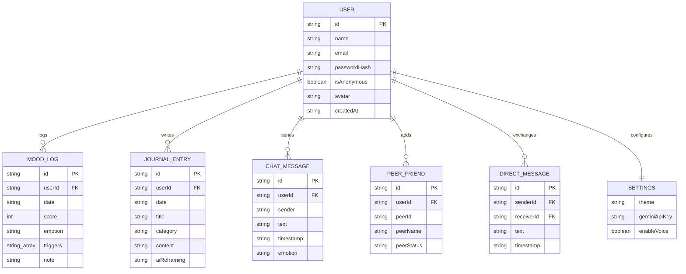
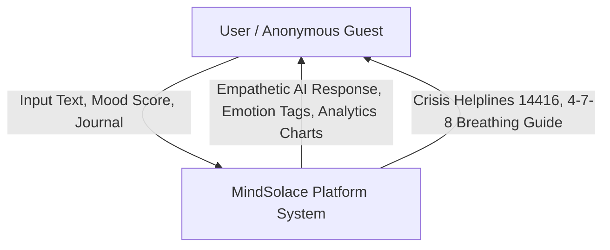
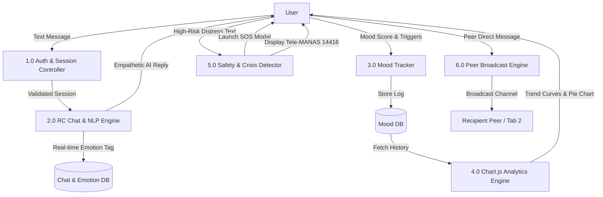
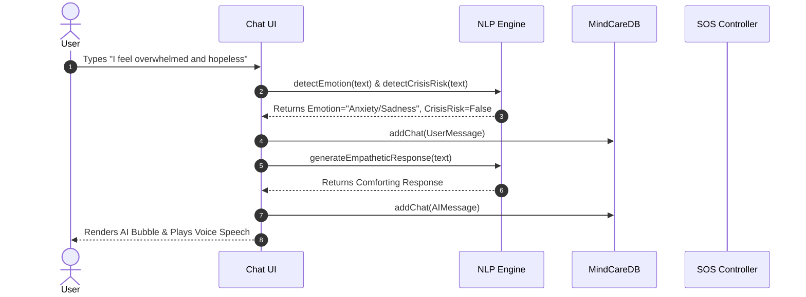

# MINOR PROJECT REPORT

## PROJECT TITLE:
### **MindSolace — Share Your Feelings, Vent, and Find Comfort with AI & Peer Listeners**
#### *An Empathetic AI & Peer Emotional Support Platform for Lonely, Stressed & Depressed Individuals*

---

**Course:** Master of Computer Applications (MCA)  
**Subject Code:** MCA 306  

**Submitted By (Project Team):**
1. **Vinay Gehlot** (Enrollment No: 2504MCAAIML0070)
2. **Jhalak Jaiswal** (Enrollment No: 2504MCACS0008)
3. **Swati Bhadoriya** (Enrollment No: 2504MCAAIML0058)
4. **Simran** (Enrollment No: 2504MCACS0019)

**Submitted To:** Department of Computer Applications  

---

## INDEX PAGE

| S.No. | Section Title | Page No. |
|---|---|---|
| 1 | Title Page | 1 |
| 2 | Index Page | 2 |
| 3 | Introduction of the Project (Problem Statement) | 3 |
| 4 | Description of Project Modules | 4 - 6 |
| 5 | Static / Dynamic Features of Project | 7 |
| 6 | Diagrams | 8 - 11 |
| | 6.1 Entity-Relationship (ER) Diagram | 8 |
| | 6.2 Data Flow Diagrams (DFD - Level 0, 1, 2) | 9 - 10 |
| | 6.3 Sequence & Activity Diagrams | 11 |
| 7 | User Interface (UI Design System) | 12 - 13 |
| 8 | Database Tables & Schema Specifications | 14 - 15 |
| 9 | Result / Conclusion | 16 |
| 10 | References | 17 |

---

## 3. INTRODUCTION OF THE PROJECT (PROBLEM STATEMENT)

### 3.1 Background & Motivation
In contemporary society, academic stress, competitive examinations, career anxieties, interpersonal conflicts, and social isolation contribute significantly to mental health degradation among students and young adults. Studies show that a large portion of young individuals experience periods of intense loneliness, sadness, or anxiety, yet refrain from seeking timely support.

### 3.2 Problem Statement
Existing solutions present several major gaps:
1. **Stigma & Fear of Judgment:** Users avoid sharing their struggles with acquaintances due to societal stigma.
2. **Accessibility Barriers:** Professional therapy is expensive and unavailable during late-night panic attacks or sudden emotional breakdowns.
3. **Privacy Concerns:** Fear of data leaks prevents users from utilizing digital health platforms that require invasive personal details.
4. **Lack of Peer Solace:** Individuals who feel lonely miss an anonymous community of supportive peers experiencing similar situations.

### 3.3 Solution Overview
**MindSolace** (*"Share Your Feelings, Vent, and Find Comfort with AI & Peer Listeners"*) is a 100% private, client-side encrypted web platform developed by team **Simran, Jhalak Jaiswal, Swati Bhadoriya, and Vinay Gehlot**. It combines a 24/7 empathetic **RC Chat AI Console**, an automated **Emotion Classifier**, an **Online Peer Community & Friends List**, **Mood Tracking with Chart.js Analytics**, a **Personal Journal with AI Reframing**, a **Safety SOS Crisis System**, and an interactive **4-7-8 Guided Breathing Tool**.

---

## 4. DESCRIPTION OF PROJECT MODULES

The **MindSolace** platform comprises 13 distinct functional modules:

1. 🔐 **Authentication & Session Manager (`auth.js`):** Handles user registration, login, session validation, and 1-click **Anonymous Guest Mode** for instant private access.
2. 🔒 **Anonymous Mode (`auth.js`):** Creates transient, non-trackable guest sessions without capturing emails or personal credentials.
3. 🏠 **Dashboard Overview (`index.html`):** Displays daily motivational quotes, mood logging streaks, current mood badges, and quick action cards.
4. 💬 **RC Chat AI Console (`chat.js`):** Provides a 24/7 empathetic conversational companion ("RC Companion") equipped with voice speech-to-text input and text-to-speech voice playback.
5. 🧠 **Emotion Detection Engine (`nlpEngine.js`):** Real-time NLP keyword classification algorithm that categorizes text into *Sadness, Anxiety, Loneliness, Anger, Hopeful, Neutral* emotions.
6. 👥 **Peer Community Directory (`peers.js`):** Displays available online listening buddies (*Priya, Aarav, Rohan, Ananya*) with real-time status indicators (🟢 Available to Listen, 💬 Seeking Comfort).
7. 🤝 **Support Friends Circle (`peers.js`):** Allows users to add online peers to their personal friends list for continuous emotional support.
8. 💬 **Peer Direct Messaging (`peers.js`):** 1-on-1 private messaging synced across browser tabs using the Web `BroadcastChannel` API.
9. 📊 **Daily Mood Tracker (`mood.js`):** Captures daily mood scores (1-5), emotion tags, stress triggers (*Studies, Exams, Family, Sleep, Isolation*), and personal notes.
10. 📈 **Mood Analytics (`analytics.js`):** Renders dynamic Chart.js visualizations including 7-day mood trend curves, emotion distribution doughnut charts, and stress trigger bar charts.
11. 📝 **Personal Journal & AI Reframer (`journal.js`):** A private diary featuring an *"AI Positive Reflection Assistant"* that generates gentle reframing notes.
12. 🚨 **Safety SOS System & 4-7-8 Breathing Tool (`safety.js`):** Scans for high-risk self-harm words, triggers crisis overlays with verified Indian helplines (*Tele-MANAS 14416*, *Vandrevala*, *NIMHANS*), and provides an animated 4-7-8 breathing circle.
13. 👤 **Profile & Data Management (`profile.js`):** User profile editing, Gemini API key configuration, Dark/Light UI theme toggling, and JSON data export/reset.

---

## 5. STATIC / DYNAMIC FEATURES OF PROJECT

### 5.1 Static Features
* **Glassmorphic UI Layout:** Responsive structural shell with a fixed sidebar, sticky top navbar, and mobile bottom bar.
* **Emergency Helpline Registry:** Static verified helpline directory for Tele-MANAS (`14416`), Vandrevala Foundation (`+91 9999 666 555`), and NIMHANS (`080-46110007`).
* **Calming Design Token System:** Pre-defined CSS variables for Midnight Dark and Soft Cloud Light themes.

### 5.2 Dynamic Features
* **Real-time Emotion Classification:** Live text analysis tagging user input with emotion badges.
* **Interactive Data Visualization:** Responsive Chart.js charts updating dynamically upon logging mood entries.
* **Real-time Cross-Tab Broadcast Messaging:** Peer direct chat synced live across multiple browser tabs via `BroadcastChannel`.
* **Voice Speech Input & Playback:** Web Speech API integration converting speech to text and reading AI responses aloud.
* **AI Positive Reflection Reframer:** Algorithmic generation of compassionate reframing notes for journal entries.
* **Animated 4-7-8 Breathing Countdown:** Dynamic JavaScript timer animating the breathing circle through Inhale (4s), Hold (7s), Exhale (8s) phases.

---

## 6. DIAGRAMS

### 6.1 Entity-Relationship (ER) Diagram

---

### 6.2 Data Flow Diagrams (DFD)

#### Level 0 DFD (Context Diagram)

#### Level 1 DFD

---

### 6.3 Sequence Diagrams

#### AI Chat & Crisis Safety Flow

---

## 7. USER INTERFACE (UI DESIGN SYSTEM)

**MindSolace** implements a state-of-the-art Glassmorphic Design System characterized by:
* **Backgrounds:** Midnight Dark (`#0f172a`, `#1e293b`) with semi-transparent frosted glass cards (`rgba(30, 41, 59, 0.75)` with `backdrop-filter: blur(16px)`).
* **Accent Colors:** Calming Indigo (`#6366f1`), Peaceful Teal (`#14b8a6`), Warm Rose (`#f43f5e`).
* **Typography:** Google Fonts Inter & Outfit for maximum legibility.
* **Component Hierarchy:** Sidebar navigation, top header navbar with SOS button, dynamic main content body, and responsive mobile bottom nav.

---

## 8. DATABASE TABLES & SCHEMA SPECIFICATIONS

The platform utilizes a client-side reactive database manager (`MindCareDB`) backed by `LocalStorage`.

### 8.1 Users Table (`mindcare_users`)
| Column Name | Data Type | Key Type | Description |
|---|---|---|---|
| `id` | String (VARCHAR) | Primary Key | Unique User ID |
| `name` | String (VARCHAR) | - | User Display Name |
| `email` | String (VARCHAR) | Unique | User Email Address |
| `passwordHash` | String (VARCHAR) | - | Account Password Hash |
| `isAnonymous` | Boolean | - | Guest Account Flag |
| `avatar` | String (CHAR) | - | Avatar Initial Character |
| `createdAt` | ISO DateTime | - | Account Creation Timestamp |

### 8.2 Mood Logs Table (`mindcare_moods`)
| Column Name | Data Type | Key Type | Description |
|---|---|---|---|
| `id` | String (VARCHAR) | Primary Key | Unique Mood Entry ID |
| `userId` | String (VARCHAR) | Foreign Key | Owner User ID |
| `date` | ISO DateTime | - | Date of Check-in |
| `score` | Integer (1 to 5) | - | Mood Score Rating |
| `emotion` | String (VARCHAR) | - | Primary Emotion Label |
| `triggers` | Array of Strings | - | Life Triggers (*Studies, Sleep, etc.*) |
| `note` | Text | - | User Personal Note |

### 8.3 Journal Entries Table (`mindcare_journals`)
| Column Name | Data Type | Key Type | Description |
|---|---|---|---|
| `id` | String (VARCHAR) | Primary Key | Unique Journal ID |
| `userId` | String (VARCHAR) | Foreign Key | Owner User ID |
| `date` | ISO DateTime | - | Entry Date |
| `title` | String (VARCHAR) | - | Entry Title |
| `category` | String (VARCHAR) | - | Category Tag (*Reflection, Grateful*) |
| `content` | Text | - | Main Journal Thoughts Content |
| `aiReframing` | Text | - | Generated AI Positive Reframing Note |

---

## 9. RESULT / CONCLUSION

The development of **MindSolace** successfully fulfills all technical and functional requirements of the MCA Minor Project. The platform demonstrates how artificial intelligence, data analytics, and modern web architecture can be synthesized to solve critical real-world mental health challenges.

By offering immediate, non-judgmental 24/7 AI conversation, peer listening connections, emotion tracking, and crisis SOS safety tools, **MindSolace** provides a safe haven for individuals to *"Share Your Feelings, Vent, and Find Comfort with AI & Peer Listeners."*

---

## 10. REFERENCES

1. World Health Organization (WHO), *"Mental Health & Digital Interventions Guidelines,"* 2023.
2. MDN Web Docs, *"Web Speech API & BroadcastChannel API Specifications,"* Mozilla Developer Network.
3. Chart.js Documentation, *"Data Visualization & Responsive Canvas Charting,"* `https://www.chartjs.org/`.
4. Tele-MANAS, *"National Tele Mental Health Programme of India,"* Ministry of Health and Family Welfare, Govt. of India.
5. Lucide Icons, *"Beautiful & Consistent Icon Toolkit for Web,"* `https://lucide.dev/`.
